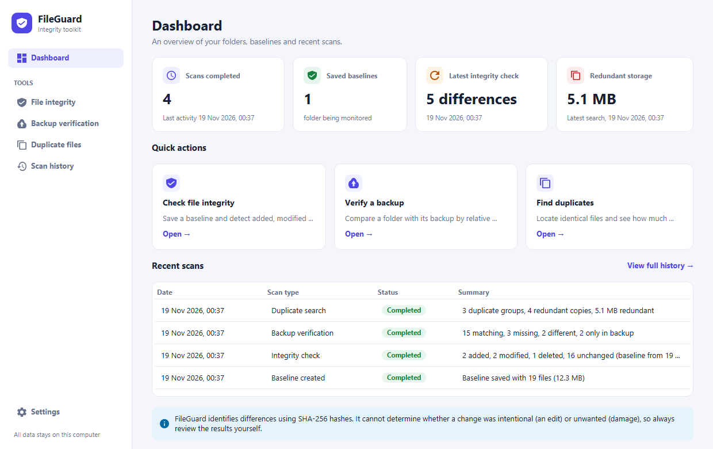
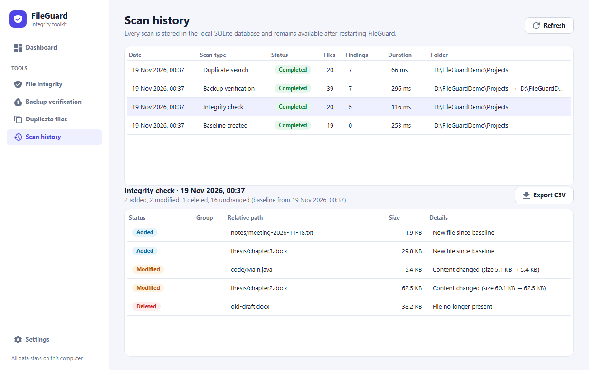
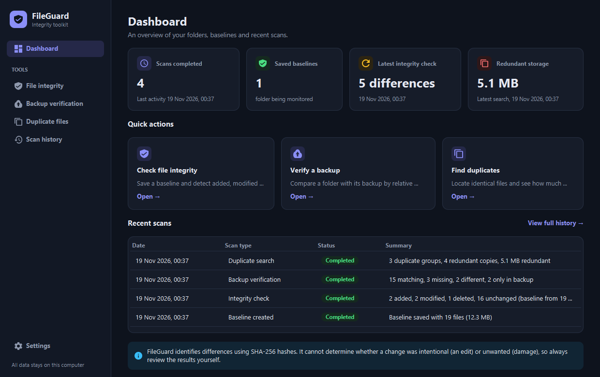
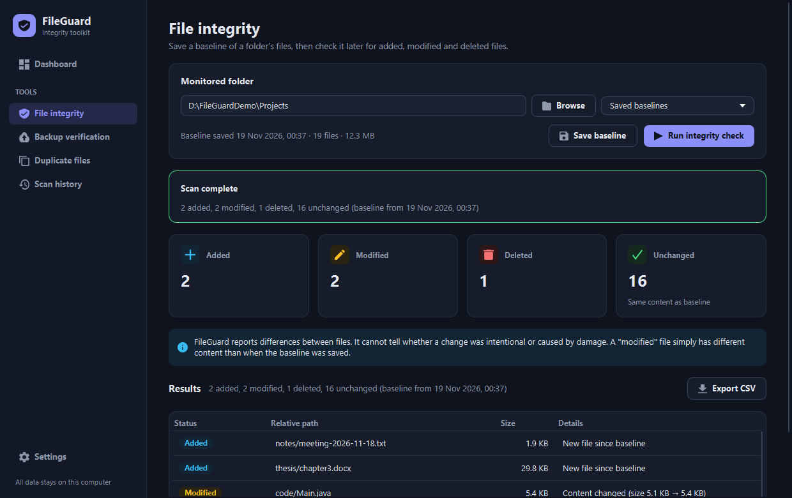
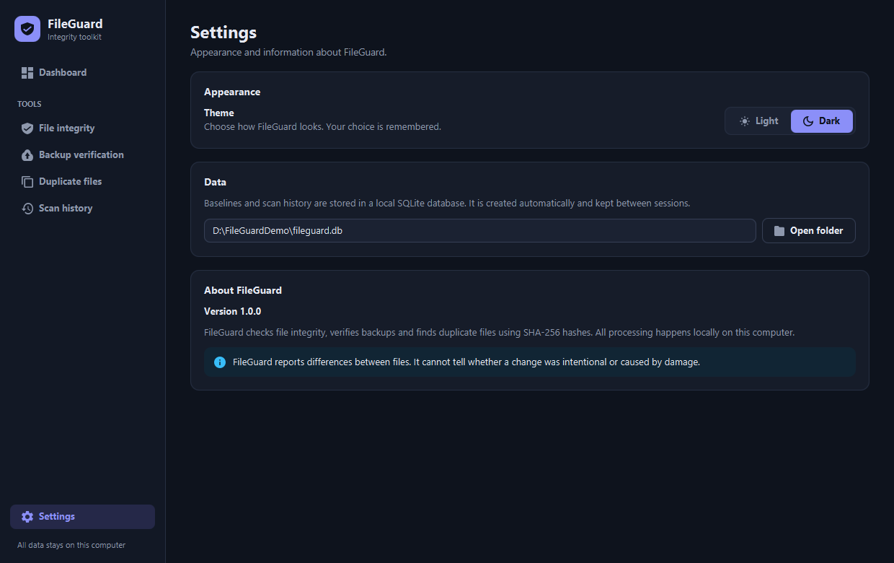

# FileGuard

FileGuard is a JavaFX desktop app for checking file integrity, verifying backups and finding duplicate files. It compares file contents with **SHA-256** hashes and keeps its scan history in a local **SQLite** database.

> **Important:** FileGuard *identifies differences*. It cannot tell whether a change was intentional (an edit) or unwanted (damage or corruption). Always review the results yourself.

---

## Features

| Feature | What it does |
|---|---|
| **File integrity monitoring** | Saves a *baseline* (relative path, size, timestamp and SHA-256 hash of every file) for a folder. Later scans compare the folder with the baseline and report **added**, **modified** and **deleted** files. |
| **Backup verification** | Compares an original folder with its backup by **relative path**. Reports files **missing in the backup**, files whose **content differs**, and files that exist **only in the backup**. Files with different sizes count as different without hashing; files with the same size are compared by hash. |
| **Duplicate detection** | Groups files with identical content (same SHA-256), shows each duplicate group and the **redundant storage** (space used by the extra copies). Only files that share a size with another file get hashed. |
| **Scan history** | Every scan, including cancelled ones, is saved in SQLite with its results. You can open earlier scans on the History page after restarting the app. |
| **Report export** | Export any result (current or from history) as a **CSV** file that opens in Excel or LibreOffice. |
| **Background scanning** | Scans run in a JavaFX `Task` on a background thread, with a progress bar, the current file, and a **Cancel** button. Cancelling is cooperative and safe: nothing half-finished is saved. |
| **Light / dark theme** | Change it in Settings. FileGuard remembers your choice. |

Unreadable files (permission denied, locked, deleted during the scan) never stop a scan. They show up as **Skipped** rows so you can see what was left out.

## Technology stack

- **Java 21** (LTS)
- **JavaFX 21** (controls + CSS styling)
- **Maven** (build and dependencies)
- **SQLite** through the **sqlite-jdbc** driver (JDBC, prepared statements)
- **Java Security API** (`MessageDigest`, SHA-256)
- **JUnit 5** (unit and integration tests)

## Prerequisites

- **JDK 21** or newer ([Eclipse Temurin](https://adoptium.net/) is recommended). Check with `java -version`.
- **Maven 3.8+** (check with `mvn -version`). You don't need it if you only run the project from IntelliJ IDEA, which has Maven built in.
- An internet connection the first time you build, so Maven can download JavaFX, SQLite JDBC and JUnit.

You don't need to install or configure any database server: the SQLite database is created automatically.

## Installation and setup

```bash
git clone <your-repository-url>
cd FileGuard
mvn clean compile
```

## Running from IntelliJ IDEA

1. **File → Open…** and select the `FileGuard` folder (the one that contains `pom.xml`). Open it as a Maven project.
2. Wait for IntelliJ to download the dependencies (progress is shown in the status bar).
3. Make sure the project SDK is Java 21: **File → Project Structure → Project → SDK**.
4. Pick one of these:
   - Open the **Maven** tool window → `FileGuard` → **Plugins → javafx → javafx:run** (double-click), **or**
   - Open `src/main/java/com/fileguard/Launcher.java` and click the green ▶ next to `main`.

> Use `Launcher` (not `FileGuardApp`) as the main class. It is a plain class that starts JavaFX, so the app runs with JavaFX on the normal classpath and you don't need any VM options.

## Running from the terminal (Maven)

```bash
# compile and start the application
mvn clean javafx:run

# run the unit tests
mvn test
```

## Project folder structure

```
FileGuard/
├── pom.xml                         Maven build (JavaFX, SQLite JDBC, JUnit 5)
├── README.md
├── .gitignore
├── docs/screenshots/               README images
└── src/
    ├── main/
    │   ├── java/com/fileguard/
    │   │   ├── Launcher.java       main() entry point
    │   │   ├── FileGuardApp.java   JavaFX Application: opens DB, shows window
    │   │   ├── model/              Plain data records and enums
    │   │   │   ├── FileEntry.java, ResultItem.java, ScanReport.java, BaselineInfo.java
    │   │   │   └── ScanType.java, ScanStatus.java, ResultStatus.java
    │   │   ├── core/               File processing (no UI, no database)
    │   │   │   ├── FileHasher.java        streamed SHA-256 hashing
    │   │   │   ├── FolderScanner.java     walks folders, hashes file lists with progress
    │   │   │   ├── IntegrityChecker.java  baseline vs current comparison
    │   │   │   ├── BackupVerifier.java    original vs backup comparison
    │   │   │   ├── DuplicateFinder.java   duplicate grouping
    │   │   │   ├── ReportExporter.java    CSV export
    │   │   │   ├── ProgressListener.java  progress + cancellation interface
    │   │   │   └── Format.java            byte/date formatting helpers
    │   │   ├── db/                 Database access (JDBC)
    │   │   │   ├── Database.java          connection + schema creation
    │   │   │   ├── BaselineDao.java       baselines and their files
    │   │   │   └── ScanHistoryDao.java    scans and their results
    │   │   ├── service/
    │   │   │   └── ScanService.java       runs scans and saves them to history
    │   │   └── ui/                 JavaFX user interface
    │   │       ├── MainWindow.java, Page.java, AppContext.java
    │   │       ├── ScanTask.java          background Task wrapper
    │   │       ├── ThemeManager.java, Icons.java, UiUtil.java
    │   │       ├── components/            FolderField, StatCard, ResultsTable,
    │   │       │                          ScanProgressPanel, StatusBadge
    │   │       └── views/                 Dashboard, Integrity, Backup, Duplicates,
    │   │                                  History, Settings pages
    │   └── resources/com/fileguard/css/
    │       ├── base.css                   layout and component styles
    │       ├── theme-light.css            light colour tokens
    │       └── theme-dark.css             dark colour tokens
    └── test/java/com/fileguard/
        ├── core/FileHasherTest.java       SHA-256 known values, large files, cancellation
        ├── core/ComparisonTest.java       integrity, backup and duplicate logic
        └── service/ScanServiceTest.java   end-to-end with real SQLite, restart, CSV, cancel
```

### How the layers fit together

```
UI (views)  ──►  ScanTask (background thread)  ──►  ScanService  ──►  core/* (files, hashing)
                                                         │
                                                         └──►  db/* DAOs  ──►  SQLite file
```

`core` knows nothing about JavaFX or SQL, so it is easy to unit-test. The UI never touches files or SQL directly.

## Database

- **Location:** `~/.fileguard/fileguard.db` (on Windows: `C:\Users\<you>\.fileguard\fileguard.db`). The **Settings** page shows the exact path. You can choose a different file with `-Dfileguard.db=path/to/file.db`.
- The database is created automatically on first start and is kept between sessions.
- **Tables:**

| Table | Contents |
|---|---|
| `baselines` | One row per monitored folder: path, creation time, file count, total size |
| `baseline_files` | Relative path, size, last-modified time and SHA-256 of each file in a baseline |
| `scans` | Scan history: type, folders, start time, duration, status, counts, summary |
| `scan_results` | Detailed result rows of each scan (status, relative path, details, size, duplicate group) |

All queries use `PreparedStatement`, all resources are closed with try-with-resources, and multi-row writes run in a single transaction. Deleting a baseline or scan also deletes its rows (`ON DELETE CASCADE`).

## Screenshots

All screenshots come from the real application running on sample data (a project folder with a baseline, later edits, a slightly outdated backup and some duplicate photos).

### Dashboard


### File integrity check
A baseline was saved, then two files were edited, one was deleted and two were added.


### Backup verification


### Duplicate files


### Scan history
Previous scans are loaded from SQLite. Selecting a scan shows its stored results.


### Dark theme




## Known limitations

- FileGuard reports **differences only**. It can't decide whether a change is legitimate or corruption.
- Integrity checks and backup verification read file contents, so very large folders take time (the speed depends on your disk).
- Paths are compared exactly as text. On Windows, renaming a file by case only (e.g. `Photo.JPG` → `photo.jpg`) shows up as one deleted and one added file.
- Symbolic links and junctions are **not followed** (to avoid loops and counting files twice).
- Empty (0-byte) files are ignored by duplicate detection.
- A file that changes *while* it is being hashed may be reported in whichever state was read.
- Each folder has one baseline. Saving a new baseline replaces the old one (FileGuard asks you to confirm first).
- Reports are exported as CSV only.

## What to commit to GitHub

**Include:**
- `pom.xml`
- `src/` (all Java sources, CSS resources and tests)
- `README.md`
- `.gitignore`
- `docs/screenshots/` (the images used in this README)

**Do not include** (already covered by `.gitignore`):
- `target/` (compiled classes and build output, regenerated by Maven)
- `.idea/`, `*.iml`, `out/` (IntelliJ project files, different on every machine)
- `*.db` (your personal scan history; the app creates a fresh database automatically)
- exported `*.csv` reports and log files
