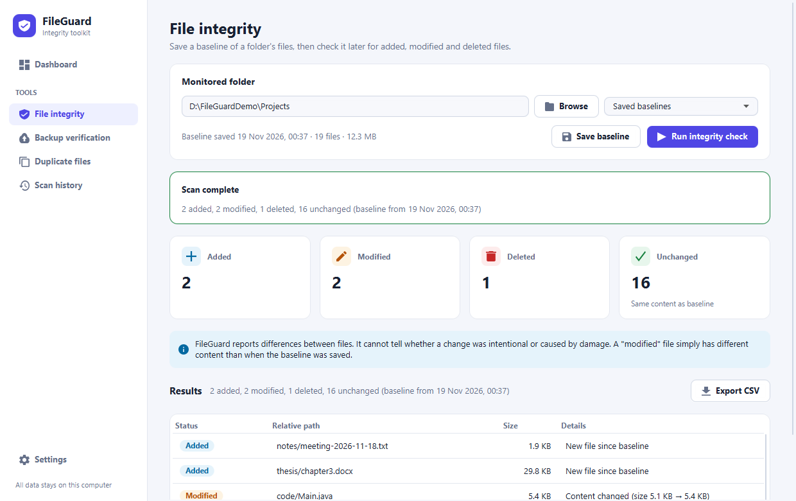
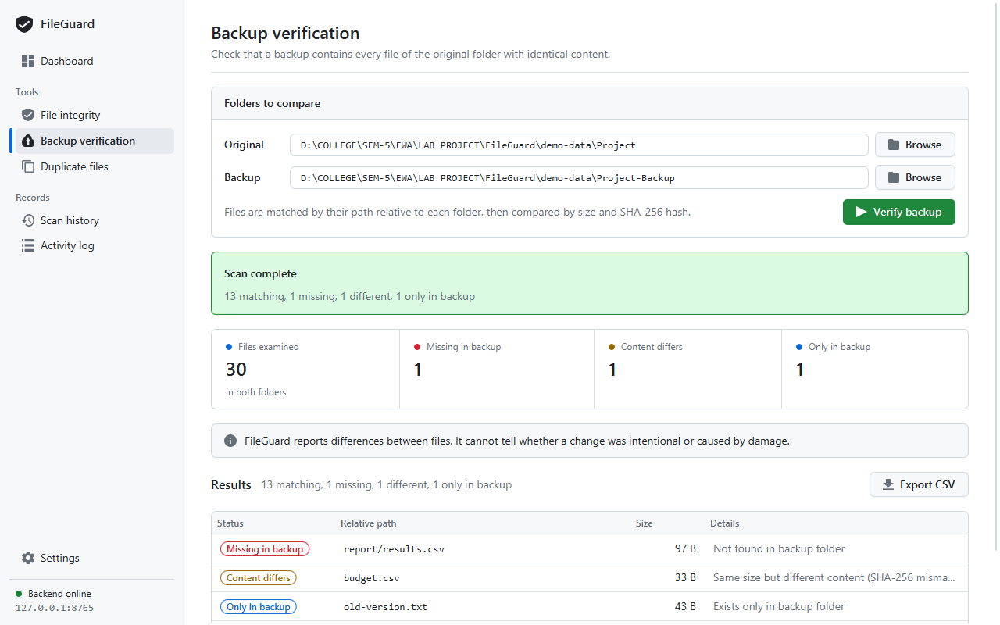
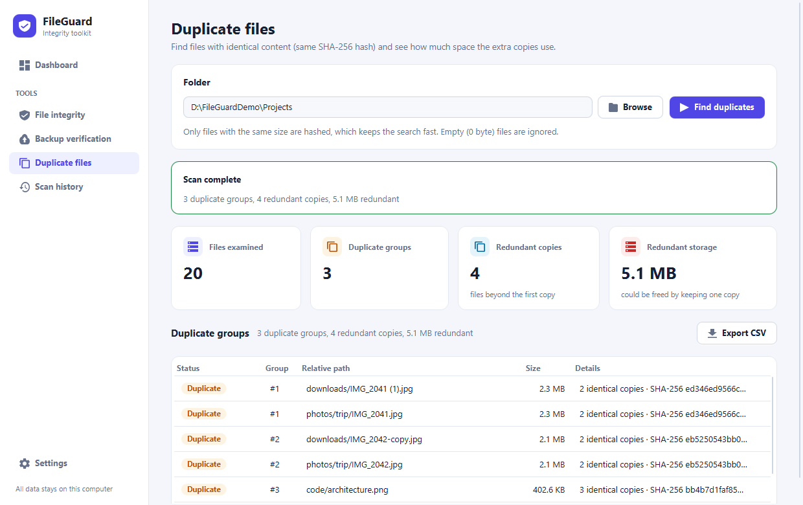
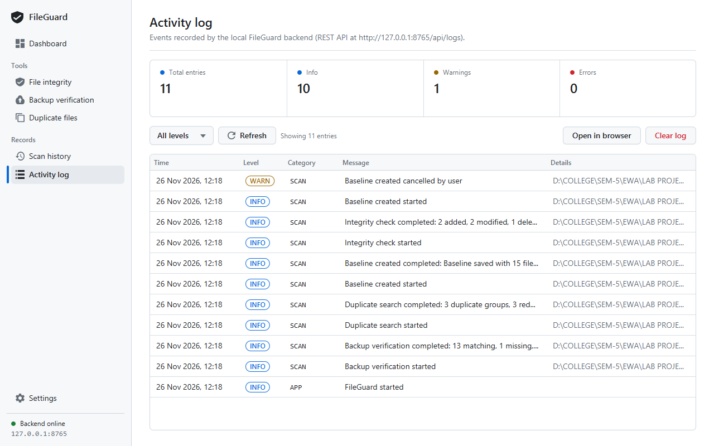
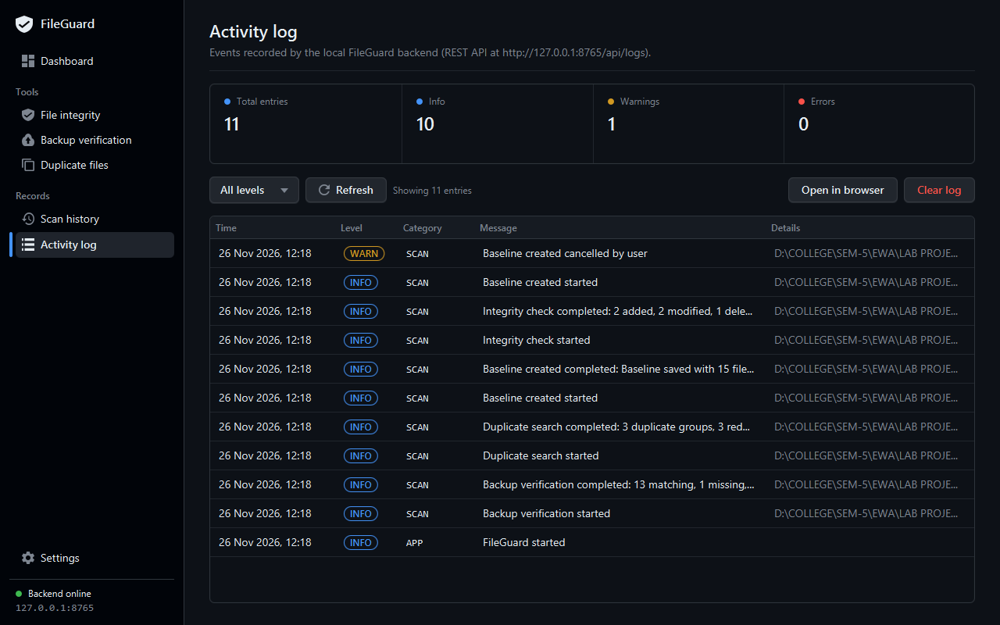

# FileGuard

FileGuard is a Windows desktop app for checking file integrity, verifying backups and finding duplicate files. It compares file contents with **SHA-256** hashes, keeps its scan history in a local **SQLite** database, and records activity in a small **local backend** (a REST server on `127.0.0.1:8765`).

> **Important:** FileGuard *identifies differences*. It cannot tell whether a change was intentional (an edit) or unwanted (damage or corruption). Always review the results yourself.


**Project documents:** [Design & diagrams](docs/DESIGN.md) · [Testing](docs/TESTING.md) · [Demo script](DEMO.md) · [Viva guide](docs/VIVA.md) · [Rubric evidence](docs/RUBRIC.md)

---

## Run it (no commands)

1. Double-click **`packaging\build-windows-app.bat`** once. It builds the app into `dist\FileGuard\` (about a minute).
2. Double-click **`dist\FileGuard\FileGuard.exe`**.

That's it. The app folder includes its own Java runtime, so it runs on any Windows 10/11 PC without installing Java. To give it to someone else, send them `dist\FileGuard-1.1.0-windows.zip`: they unzip it and double-click `FileGuard.exe`.

The folder also contains **`FileGuard Backend.exe`**, which runs only the backend in a console window. That's handy for showing it as a separate process (see [Backend](#local-backend)).

> Building needs **JDK 21** installed once (it includes the `jpackage` tool). Maven is **not** needed: the project ships with the Maven wrapper (`mvnw.cmd`), which downloads Maven automatically.

---

## Features

| Feature | What it does |
|---|---|
| **File integrity monitoring** | Saves a *baseline* (relative path, size, timestamp and SHA-256 of every file) for a folder. Later scans report **added**, **modified** and **deleted** files. |
| **Backup verification** | Compares an original folder with its backup by **relative path**. Reports files **missing in the backup**, files whose **content differs**, and files that exist **only in the backup**. Files with different sizes count as different without hashing. |
| **Duplicate detection** | Groups files with identical content and shows the **redundant storage** used by the extra copies. Only files that share a size with another file get hashed. |
| **Scan history** | Every scan, including cancelled ones, is saved in SQLite with its results and stays available after a restart. |
| **Report export** | Export any result (current or from history) as a **CSV** file for Excel or LibreOffice. |
| **Background scanning** | Scans run on a background thread (JavaFX `Task`) with a progress bar, the current file and a **Cancel** button. Cancelling is safe: nothing half-finished is saved. |
| **Local backend + activity log** | A REST server built only from parts of Java stores activity logs (scans started, completed, cancelled or failed; app start; theme changes) in its own SQLite database. View them on the **Activity log** page or in a browser at `http://127.0.0.1:8765/`. |
| **Light / dark theme** | Colours from GitHub's Primer design system. FileGuard remembers your choice. |

Unreadable files (permission denied, locked, deleted during the scan) never stop a scan. They show up as **Skipped** rows.

## Technology stack

- **Java 21** (LTS) and **JavaFX 21** with CSS styling
- **SQLite** via **sqlite-jdbc** (JDBC with prepared statements)
- **Java Security API**: `MessageDigest` for SHA-256
- **Backend:** the JDK's built-in HTTP server (`com.sun.net.httpserver`) with a hand-written JSON helper; the app talks to it with the built-in `java.net.http.HttpClient`
- **Maven** (through the Maven wrapper), **JUnit 5** and **JaCoCo** (test coverage)
- **jpackage** (part of the JDK) to build `FileGuard.exe`

No web frameworks, cloud services or external database servers.

## Local backend

```
┌────────────────────┐   HTTP (JSON)    ┌──────────────────────────┐
│  FileGuard app     │ ───────────────► │  FileGuard backend       │
│  (JavaFX)          │  POST /api/logs  │  127.0.0.1:8765          │
│  BackendClient     │ ◄─────────────── │  BackendServer           │
│                    │  GET  /api/logs  │  LogRepository → SQLite  │
└────────┬───────────┘                  └──────────┬───────────────┘
         │                                         │
   fileguard.db                               backend.db
   (baselines, scan history)                  (activity logs)
```

- **Starts automatically.** When FileGuard opens, it checks `http://127.0.0.1:8765/api/health`. If a FileGuard backend is already running (for example `FileGuard Backend.exe`), it uses that one; otherwise it starts the backend inside the app.
- **Never blocks the UI.** Logs are sent asynchronously. If the backend is offline, logs wait in a queue and are sent when it's back. The sidebar shows **Backend online/offline**.
- **Local only.** The server listens on `127.0.0.1`, so other computers can't reach it. Request bodies are limited to 16 KB and every field is validated.

| Method | Path | Purpose |
|---|---|---|
| `GET` | `/api/health` | Is the backend running? (service name, version, uptime) |
| `GET` | `/api/logs?limit=&level=&category=` | List logs, newest first |
| `POST` | `/api/logs` | Add a log: `{"level":"INFO","category":"SCAN","message":"…","details":"…"}` |
| `DELETE` | `/api/logs` | Delete all logs |
| `GET` | `/api/stats` | Count of logs per level |
| `GET` | `/` | Log viewer web page |

Every response uses the same envelope: `{"success": true, "data": …, "error": null}`.

## Running from IntelliJ IDEA (for development)

1. **File → Open…** and select the `FileGuard` folder (the one with `pom.xml`).
2. Set the project SDK to **Java 21** (**File → Project Structure → Project**).
3. Run `src/main/java/com/fileguard/Launcher.java` (green ▶ next to `main`).

To run only the backend, run `com.fileguard.server.BackendServer`.

## Running from a terminal (optional)

```powershell
.\mvnw.cmd javafx:run       # start the app
.\mvnw.cmd test             # run the 36 unit and integration tests (+ coverage report)
```

## Project folder structure

```
FileGuard/
├── pom.xml                          Maven build (JavaFX, SQLite JDBC, JUnit 5, packaging)
├── mvnw.cmd, mvnw, .mvn/            Maven wrapper (no Maven install needed)
├── README.md, DEMO.md               documentation and presentation script
├── packaging/
│   ├── build-windows-app.bat        double-click: builds dist\FileGuard\FileGuard.exe
│   ├── backend-launcher.properties  second launcher: FileGuard Backend.exe
│   └── fileguard.ico                app icon
├── demo/                            setup-demo.ps1, simulate-changes.ps1, sample-images/
├── docs/
│   ├── DESIGN.md                    problem, objectives, architecture, UML and ER diagrams
│   ├── TESTING.md                   test cases, coverage, UI test plan, validation
│   ├── VIVA.md                      code map and viva preparation
│   ├── RUBRIC.md                    evidence for each evaluation criterion
│   └── screenshots/                 README images
└── src/
    ├── main/java/com/fileguard/
    │   ├── Launcher.java            main() entry point
    │   ├── FileGuardApp.java        opens DB, connects/starts backend, shows window
    │   ├── model/                   records and enums (ScanReport, LogEntry, …)
    │   ├── core/                    hashing, scanning, comparisons, CSV export (no UI, no SQL)
    │   ├── db/                      Database, BaselineDao, ScanHistoryDao (JDBC)
    │   ├── service/                 ScanService (runs + saves scans), ActivityLogger
    │   ├── server/                  backend: BackendServer, LogRepository, Json
    │   ├── client/                  BackendClient (HTTP client used by the app)
    │   └── ui/                      MainWindow, ScanTask, ThemeManager, components/, views/
    ├── main/resources/com/fileguard/
    │   ├── css/                     base.css, theme-light.css, theme-dark.css
    │   ├── server/index.html        backend log viewer page
    │   └── icon.png                 window icon
    └── test/java/com/fileguard/
        ├── core/                    hashing, comparison logic
        ├── service/                 end-to-end scans with SQLite, restart, CSV, cancel
        └── server/                  JSON, REST endpoints, validation, offline queue
```

## Databases

Both are created automatically on first start and kept between sessions.

| File | Owner | Tables |
|---|---|---|
| `~/.fileguard/fileguard.db` | Desktop app | `baselines`, `baseline_files`, `scans`, `scan_results` |
| `~/.fileguard/backend.db` | Backend | `logs` (time, level, category, message, details) |

On Windows `~` is `C:\Users\<you>`. Settings shows both paths. All queries use `PreparedStatement`, resources are closed with try-with-resources, and multi-row writes run in a transaction.

## Demo

Use the prepared demo folders and the step-by-step script in **[DEMO.md](DEMO.md)**:

```powershell
powershell -ExecutionPolicy Bypass -File demo\setup-demo.ps1
```

This creates `demo-data\` with an original folder, a backup that has known problems, some duplicates and a large file for showing Cancel.

## Screenshots

| | |
|---|---|
| **Dashboard**  | **Dark theme**  |
| **File integrity**  | **Backup verification**  |
| **Duplicate files**  | **Scan history**  |
| **Activity log (backend)**  | **Activity log, dark**  |

## Known limitations

- FileGuard reports **differences only**. It can't decide whether a change is legitimate or corruption.
- Paths are compared exactly as text. On Windows, renaming a file by case only shows up as one deleted and one added file.
- Symbolic links and junctions are not followed. Empty (0-byte) files are ignored by duplicate detection.
- Each folder has one baseline. Saving a new one replaces the old one (after a confirmation).
- The backend uses port **8765**. If another program uses that port, FileGuard still works but shows *Backend offline* and keeps logs queued until it can deliver them.
- The packaged app is built for Windows. On macOS or Linux, run it from IntelliJ or with `mvnw javafx:run`.

## What to commit to GitHub

**Include:** `pom.xml`, `mvnw*`, `.mvn/`, `src/`, `packaging/`, `demo/`, `docs/`, `README.md`, `DEMO.md`, `.gitignore`, `.gitattributes`.

**Don't include** (already in `.gitignore`): `target/`, `dist/` (the built app; share the zip instead, for example as a GitHub Release), `.idea/`, `*.iml`, `*.db`, `demo-data/`, `demo-results/`, exported `*.csv` files.
