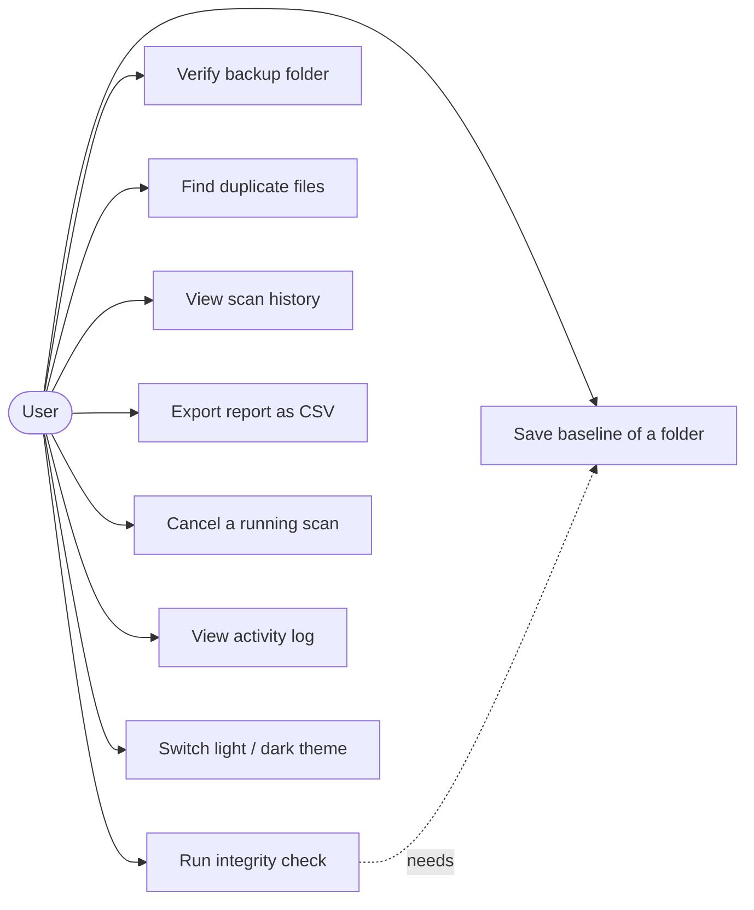
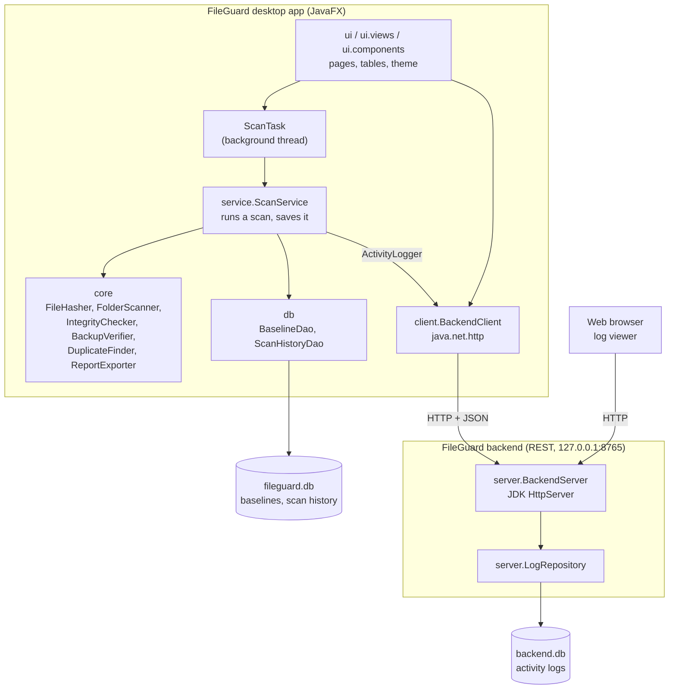
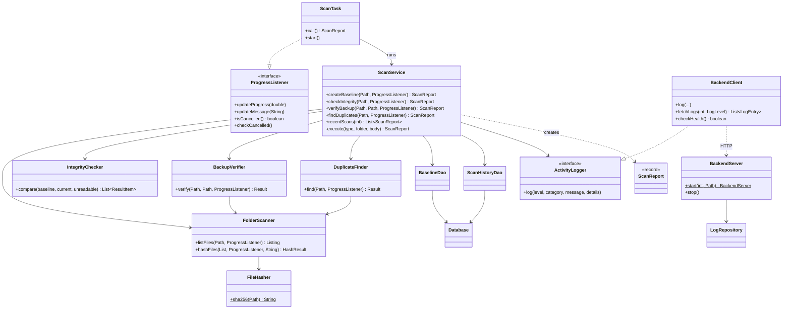
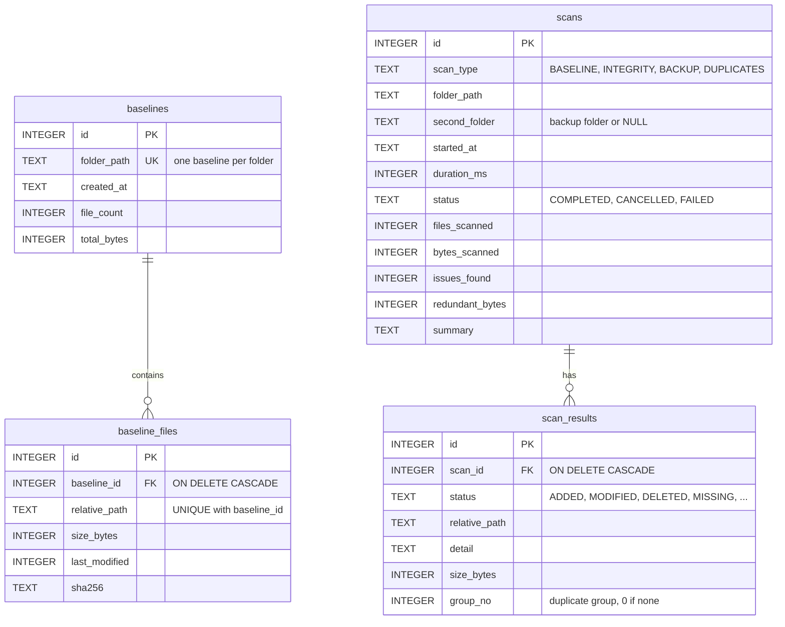
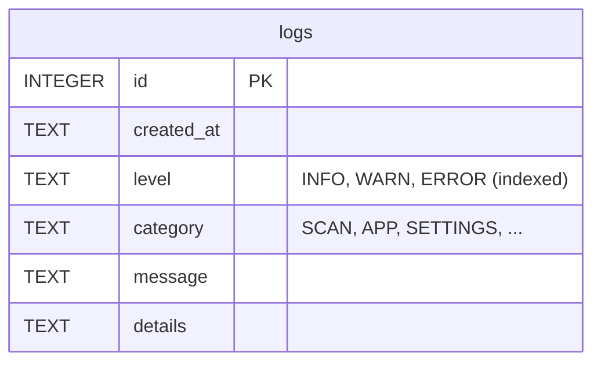
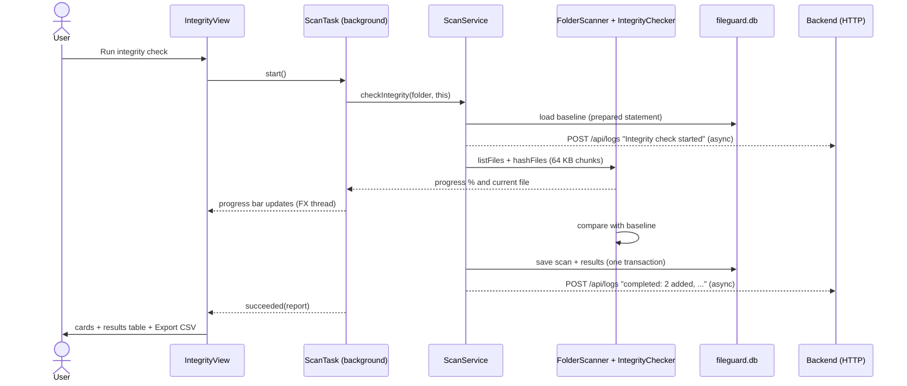

# FileGuard — Problem Identification & Project Design

## 1. Problem statement

People keep important files (assignments, photos, project code) on a laptop and copy them to a USB drive or another folder as a "backup". Three everyday problems follow:

1. **Silent changes.** A file can change without anyone noticing: an accidental save, a sync tool overwriting a newer version, or real damage. Looking at names or dates doesn't reveal this, because a file can keep the same name, size and date while its content changes.
2. **Incomplete backups.** A copy that was interrupted, or that wasn't updated after new work, looks fine until the day you need it. Comparing two folders by hand is slow and error-prone.
3. **Wasted space.** The same photo or download ends up in several places ("IMG_2041 (1).jpg"), filling the disk without anyone knowing how much space is wasted.

Existing tools are either command-line utilities (hard for normal users), part of paid backup suites, or cloud services that upload private files. There is room for a **simple, local, visual tool** that answers "has anything changed?", "is my backup complete?" and "what is duplicated?" with proof based on file *content*.

## 2. Objectives

| # | Objective | How FileGuard meets it |
|---|---|---|
| O1 | Detect added, modified and deleted files in a folder over time | Baseline of SHA-256 hashes stored in SQLite; later scans are compared with it |
| O2 | Verify that a backup matches the original | Files matched by relative path, compared by size and then by SHA-256 |
| O3 | Find duplicate files and the space they waste | Group by size, hash the candidates, group by hash |
| O4 | Keep a history of every scan, also after restarting | `scans` and `scan_results` tables; History page |
| O5 | Share results | CSV export of any current or past scan |
| O6 | Never freeze, even on large folders; allow cancelling | Background JavaFX `Task`, streamed hashing, cooperative cancel |
| O7 | Record activity in a separate back-end service | Local REST backend with its own log database |
| O8 | Be easy to install and use | Double-click `FileGuard.exe` with a bundled Java runtime; light/dark theme |

**Out of scope (on purpose):** automatic or scheduled backups, file recovery, cloud sync, user accounts. FileGuard *reports* differences; it never changes or deletes the user's files.

**Honesty rule:** a "modified" file means the content is different. FileGuard can't know whether the change was intended, so it never calls a change "corruption".

## 3. Users and use cases

## 4. Architecture

FileGuard has two parts that talk over HTTP, each with its own SQLite database. The layers inside the desktop app only depend downwards.

| Layer | Package | Responsibility | Knows about |
|---|---|---|---|
| Presentation | `ui`, `ui.views`, `ui.components` | JavaFX pages, tables, progress, theme | service, client |
| Background work | `ui.ScanTask` | Runs a scan off the UI thread, forwards progress, handles Cancel | core's `ProgressListener` |
| Business logic | `service` | Orchestrates a scan, measures it, saves it, logs it | core, db |
| File processing | `core` | Hashing, folder walking, comparisons, CSV | model only (no UI, no SQL) |
| Data access | `db` | JDBC, prepared statements, transactions | model |
| Back end | `server` | REST API, validation, log storage | model |
| Back-end client | `client` | HTTP calls, offline queue, status | server's JSON helper |
| Data | `model` | Immutable records and enums | nothing |

Because `core` doesn't depend on JavaFX or SQL, all comparison logic is unit-tested without a window or a database.

## 5. Class design (main classes)

Two small interfaces keep the layers independent:
- **`ProgressListener`** lets `core` report progress and check for Cancel without knowing about JavaFX. In the app it's implemented by `ScanTask`; tests use a simple lambda.
- **`ActivityLogger`** lets `ScanService` report events without knowing about HTTP. In the app it's implemented by `BackendClient`; tests use `ActivityLogger.NONE`.

## 6. Database design

### Desktop database — `fileguard.db`

### Backend database — `backend.db`

**Design decisions**
- **SQLite** needs no server and no setup, and the database is a single file created on first start.
- **Two databases**: the backend owns its data, as a real service would. If the backend is unavailable, scanning and history still work.
- **Folder paths are normalised** with `toRealPath()`, so `D:\Data`, `d:\data\` and a relative path all map to the same baseline (`UNIQUE` constraint).
- **`issues_found` is stored** so the history list can show counts without loading every result row.
- **Writes use transactions**: saving a baseline (delete old, insert new) is all-or-nothing.
- **All SQL uses `PreparedStatement`**, so file names can never break or inject SQL.

## 7. Key flow — integrity check

If the user presses **Cancel**, `isCancelled()` becomes true. The next chunk check throws `CancellationException`, `ScanService` records a "Cancelled" history entry and a WARN log, and nothing half-finished is saved.

## 8. Algorithms and their cost

| Task | Approach | Why |
|---|---|---|
| Hashing | SHA-256 via `MessageDigest`, read in 64 KB chunks | Constant memory for any file size; content-based, so any change is detected |
| Integrity | Map relative path → baseline entry, compare hashes; O(n) | One pass over each list |
| Backup | Compare sizes first, hash only same-size pairs | A different size already proves a difference; saves reading large files |
| Duplicates | Group by size → hash candidates → group by hash | Unique sizes can't be duplicates, so most files are never read |
| Progress | Bytes hashed ÷ total bytes | One big file moves the bar as smoothly as many small ones |

## 9. Error handling strategy

| Situation | Behaviour |
|---|---|
| File can't be read (permissions, locked) | Listed as **Skipped** with the reason; the scan continues; not reported as "deleted" |
| Folder missing, same folder twice, backup inside original | Clear message before any work starts |
| Integrity check without a baseline | "Create a baseline first" |
| Database error | Friendly message in a dialog; details aren't lost |
| Backend offline or port taken | App keeps working, sidebar shows *Backend offline*, logs are queued and sent later |
| Invalid request to the backend | `400` with a short reason; `413` for bodies over 16 KB; `500` without internal details |

## 10. UI design

- **Visual language:** GitHub's Primer design system (exact light and dark colour values), chosen because it's a well-known, professional, neutral style: thin borders, 6 px corners, outlined status labels, monospace paths.
- **Navigation:** a sidebar grouped into *Tools* (the three scans) and *Records* (history, activity log), with the backend status always visible.
- **Feedback:** every long operation shows progress, the current file and a Cancel button. Results show as summary numbers plus a sortable table.
- **Consistency:** all colours are tokens in `theme-light.css` / `theme-dark.css`; `base.css` contains layout only, so both themes always match.
